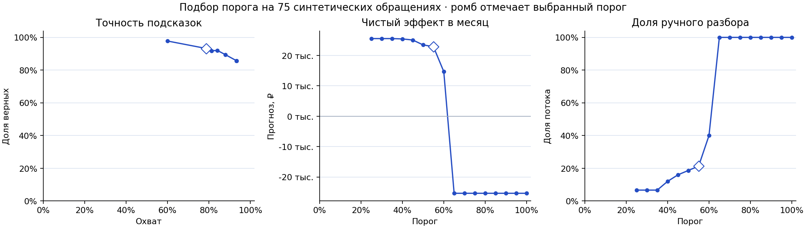

# Сравнение моделей и политика ручного разбора

В v2 используется TF-IDF и Multinomial Naive Bayes с сигмоидной калибровкой по пяти групповым фолдам Train. На итоговом тесте политика выдала 67 рекомендаций, 60 совпали с эталоном. Доля ошибок 7/90 превышает предварительный ориентир 6%. В интерфейсе каждую очередь назначает оператор.

## Протокол и сравнение

Первый эксперимент на 125 новых тренировочных строках выбрал Linear SVM на validation. Исходный v1 оказался сильнее на validation и первом контрольном наборе. Сводка сохранена в [exploratory.json](experiments/exploratory.json). Во втором эксперименте к Train добавлены 120 исходных тренировочных строк, сопоставленных семействам. Первый контрольный набор помечен как benchmark. Новый test и исполняемый протокол зафиксированы в коммите `90be94a` до вычисления прогнозов на новом test. Автор синтетического корпуса видел тексты и метки. Следующий полностью независимый тест должен подготовить другой разметчик.

Правила ищут основы слов и дают очередь при совпадениях ровно с одной темой. Три обучаемые модели используют одинаковые текстовые признаки, split и поиск порога. Исходная модель сравнивается при своих исходных параметрах. Эмбеддинги остались вне этого эксперимента. Поле выхода ограничено пятью типами, небольшой корпус недостаточен для обоснования стоимости дополнительной модели, а обязательный сценарий запускается без загрузки весов и API.

Для каждой ML-модели `experiment.py` перебирает пороги 0,25–1,00 на validation. Для подсказки нужны слова, целевой победивший класс, оценка не ниже порога и разрыв между двумя верхними оценками не менее 0,08. На validation отбрасываются варианты с ошибочными подсказками более 6% от всего потока либо recall `other` меньше 65%. Среди остальных минимизируется ожидаемое время плюс 20 секунд × долю ошибочных рекомендаций. Дополнительное время отражает условную цену риска. При равенствах предпочитаются меньшая доля ошибок и более строгий порог внутри модели. Метод и параметры в [config/experiment.json](../config/experiment.json).

| Подход | Порог | Validation, с | Ошибки validation | Охват test | Точность подсказок test | Ошибки test | Macro-F1 test |
| --- | ---: | ---: | ---: | ---: | ---: | ---: | ---: |
| Исходный v1 | 0,60 | 60,13 | 1/75 | 55,6% | 98,0% | 1/90 | 0,7588 |
| Правила | — | 72,00 | 0/75 | 36,7% | 100% | 0/90 | 0,5617 |
| Naive Bayes | 0,55 | 49,73 | 4/75 | 74,4% | 89,6% | 7/90 | 0,7993 |
| Logistic Regression | 0,45 | 57,20 | 4/75 | 70,0% | 92,1% | 5/90 | 0,8136 |
| Linear SVM | 0,50 | 50,67 | 4/75 | 73,3% | 89,4% | 7/90 | 0,7897 |

У Naive Bayes 49,73 с расчётного времени на validation и 50,80 с после штрафа. У ближайшего ML-варианта SVM 51,73 с после штрафа. Исходный метод и правила экономят меньше условного времени при более осторожной выдаче. На новом test логистическая регрессия дала лучший macro-F1 и меньше ошибок, чем Naive Bayes. Порог и модель зафиксированы по validation. Политика в продукте сохраняет этот выбор для честной демонстрации и требует повторной проверки перед внедрением.



[Все пороги и политики](experiments/thresholds.csv) · [Метрики, матрицы и паспорт модели](experiments/v2.json) · [Ошибки и случаи пропуска подсказки](experiments/errors.csv).

## Итоговый тест и неопределённость

Accuracy по пяти исходам 78,9%, Macro-F1 0,7993, Weighted-F1 0,7993. Классы сбалансированы. Macro-F1 кандидата на 72 целевых текстах без порога равен 0,9301, у исходной модели на тех же текстах 0,9167. Ошибки в потоке 7,8% (95% ДИ Уилсона 3,8–15,2%). Точность выданных подсказок 89,6% (80,0–94,8%), охват 74,4% (64,6–82,3%), доля ручного разбора 25,6%. Модель отказалась на 11 из 18 примеров вне четырёх очередей. Интервалы описывают неопределённость счётчиков при биномиальном приближении. Группировка формулировок и выбор синтетики ограничивают перенос на реальный поток.

| Истинная тема | Доступ | Оплата | Расписание | Материалы | Ручной разбор | Precision | Recall | F1 |
| --- | ---: | ---: | ---: | ---: | ---: | ---: | ---: | ---: |
| Доступ | 15 | 0 | 0 | 0 | 3 | 1,000 | 0,833 | 0,909 |
| Оплата | 0 | 16 | 0 | 0 | 2 | 0,941 | 0,889 | 0,914 |
| Расписание | 0 | 0 | 13 | 0 | 5 | 0,722 | 0,722 | 0,722 |
| Материалы | 0 | 0 | 0 | 16 | 2 | 0,941 | 0,889 | 0,914 |
| Вне очередей | 0 | 1 | 5 | 1 | 11 | 0,478 | 0,611 | 0,537 |

Для общей классификации `manual` сопоставляется с эталоном `other`. Ручной разбор целевого сообщения учитывается как пропущенная рекомендация. Selective Accuracy делит число верных рекомендаций на число выданных. Если подсказок нет, доля не определена. Метрики по классам относятся к конкретным определениям очередей, а не к оценке качества работы операторов.

## Ошибки и калибровка

Все семь принятых ошибок на итоговом тесте возникли на неизвестных темах. Уверенная ошибка `te-086` дала расписание для просьбы пересмотреть оценку с оценкой 60,7%. Пять из семи ошибок попали в расписание. Для заявок со словами о занятиях и встречах нужен отдельный разбор контекста.

На Challenge точность подсказок 25/30 = 83,3%, охват 50,0%, ошибки 5/60 = 8,3%. Модель допустила 3 ошибки на 13 смешанных сообщениях, 1 на 9 с отрицанием и 1 на 4 длинных. В `ch-001` «Оплата тут ни при чём» дала оплату, хотя запрошен вход. Среди 8 сообщений с опечатками 6 верных подсказок и 2 отказа. Все 4 малоинформативных сообщения, 7 текстов с тегом `ood` и 2 нерелевантных отправлены на разбор. Три смешанных сообщения с несколькими равными намерениями ошибочно получили очередь, поэтому близость оценок сама по себе не решает задачу.

На итоговом тесте у Naive Bayes Brier (многоклассовая сумма квадратов) вырос с 0,299 до 0,376 после калибровки. ECE по пяти равным диапазонам top-1 выросла с 0,104 до 0,224. На Challenge оба показателя, напротив, снизились: Brier с 0,591 до 0,575, ECE с 0,170 до 0,128. Качество калибровки оценили после фиксации политики. Интерфейс показывает оценку модели. Для применения в реальном потоке нужны свежие данные, повторный выбор между сырыми и откалиброванными оценками и новая проверка.

Медиана тёплого инференса на Python 3.12.7 и ARM64 Mac около 0,66 мс, p95 около 0,72 мс на 270 одиночных вызовах. Сбор включает признаки, классификатор и политику отказа. Время HTTP, запись SQLite и время оператора измеряются отдельно. Обучение выбранной модели в том же запуске заняло около 0,13 с после импортов.

## Воспроизведение

```bash
.venv/bin/python -B dataset.py
.venv/bin/python -B experiment.py
```

Версия модели зависит от хешей Train, нормализации, конфигурации, кода модели и версии scikit-learn. Приложение сверяет паспорт, обучает модель на локальных данных и подключает соответствующий отчёт. Прогнозы воспроизводятся при закреплённых зависимостях. Длительности измерений меняются между запусками. Файлы оценки перезаписываются командой эксперимента.

График пересобирается отдельно через `scripts/plot_experiment.py` с Matplotlib 3.10.8. Основному приложению Matplotlib не нужен.

## Источники методики

- scikit-learn 1.7.2, руководство по калибровке классификаторов и оценке надёжности. [Probability calibration](https://scikit-learn.org/1.7/modules/calibration.html)
- scikit-learn 1.7.2, групповые стратифицированные разбиения. [StratifiedGroupKFold](https://scikit-learn.org/1.7/modules/generated/sklearn.model_selection.StratifiedGroupKFold.html)
